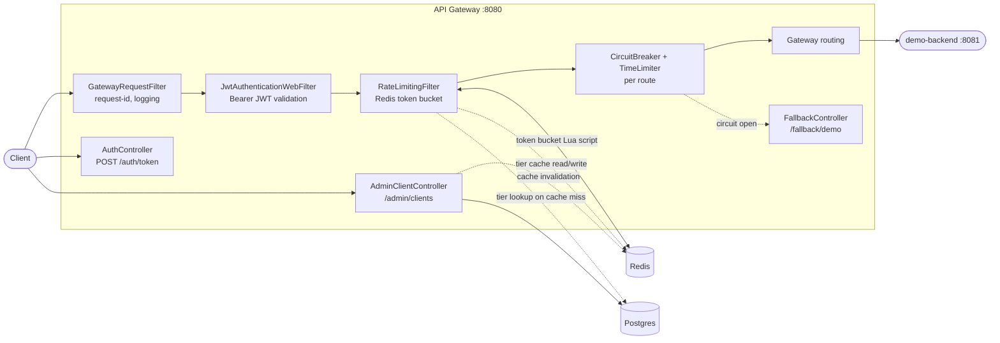

# Distributed API Gateway & Rate Limiting System

[](https://github.com/lakshmimahadevan22/rate-limiter/actions/workflows/ci.yml)

A Spring Cloud Gateway project for exploring JWT authentication, distributed rate limiting, fault tolerance, and client configuration.

## Architecture



A request to `/api/**` passes through, in order: request-ID tagging and logging, JWT bearer validation (401 if missing/invalid), Redis-backed rate limiting keyed by JWT subject (429 if exhausted), then a per-route circuit breaker before the backend is actually called (503 from `/fallback/demo` if the breaker is open or the call times out). `/auth/token` and `/admin/clients` bypass routing entirely — they're plain `@RestController`s, not gateway routes, so neither is rate-limited or circuit-broken.

## Modules

- `api-gateway`: Reactive API gateway and shared gateway dependencies.
- `demo-backend`: Minimal backend application reserved for gateway routing examples.

## Requirements

- Java 21 or later
- Apache Maven 3.9 or later

## Build

```sh
mvn clean install
```

## Run

Start the gateway:

```sh
mvn -pl api-gateway spring-boot:run
```

Start the demo backend in a separate terminal:

```sh
mvn -pl demo-backend spring-boot:run
```

The gateway listens on port `8080`; the demo backend listens on port `8081`.

## Get an access token

The development credentials default to `demo` / `demo-password`. Override them with `AUTH_USERNAME` and `AUTH_PASSWORD` before running outside a local development environment.

```sh
TOKEN=$(curl -s http://localhost:8080/auth/token \
	-H 'Content-Type: application/json' \
	-d '{"username":"demo","password":"demo-password"}' | jq -r .accessToken)
```

Requests under `/api/**` require `Authorization: Bearer <token>`. JWTs use HS256 by default; set `JWT_ALGORITHM=RS256`, `JWT_PRIVATE_KEY_PATH`, and `JWT_PUBLIC_KEY_PATH` to use PKCS#8 private and X.509 public PEM keys. Replace the development JWT secret with `JWT_SECRET` before deployment.

Authenticated API requests are rate-limited by JWT subject using an atomic Redis token bucket. The default limit is 10 requests per second with a burst capacity of 10; the `demo` client has a 5-request burst and refill rate. Configure `RATE_LIMIT_CAPACITY`, `RATE_LIMIT_REFILL_TOKENS`, and `RATE_LIMIT_REFILL_PERIOD` for the default tier, or add client entries under `gateway.rate-limit.client-limits`. Throttled requests receive `429 Too Many Requests` and a `Retry-After` header. Redis must be available for rate-limited routes.

## Try the routes

Start both applications, then call the gateway:

```sh
curl -i http://localhost:8080/api/demo/hello -H "Authorization: Bearer $TOKEN"
curl -i -X POST http://localhost:8080/api/demo/echo \
	-H "Authorization: Bearer $TOKEN" \
	-H 'Content-Type: application/json' \
	-H 'X-Demo-Route: enabled' \
	-d '{"message":"hello"}'
```

The GET route matches `Path` and `Method`; the POST route additionally requires the `X-Demo-Route: enabled` header. The gateway forwards or generates an `X-Request-Id`, returns it in the response, and logs request method, path, status, and duration.

## Fault tolerance

Both demo routes are wrapped in a Resilience4j circuit breaker (`demoBackend`) with a `TimeLimiter`. A 5xx response from `demo-backend`, or a call that exceeds the timeout, counts as a failure; once the failure-rate threshold is breached over the sliding window, the circuit opens and requests are routed straight to a fallback (`/fallback/demo`, `503 Service Unavailable`) instead of hitting the backend. After `wait-duration-in-open-state` elapses, the circuit automatically moves to half-open, allows a limited number of trial calls through, and closes again once those succeed. Tune it with `CIRCUIT_BREAKER_SLIDING_WINDOW_SIZE`, `CIRCUIT_BREAKER_MINIMUM_CALLS`, `CIRCUIT_BREAKER_FAILURE_RATE_THRESHOLD`, `CIRCUIT_BREAKER_WAIT_DURATION`, `CIRCUIT_BREAKER_HALF_OPEN_CALLS`, and `CIRCUIT_BREAKER_TIMEOUT`.

## Dynamic, database-backed rate-limit tiers

Client rate-limit tiers can be managed at runtime instead of only through static YAML. A `clients` table (Flyway-migrated on startup; requires Postgres) stores a per-client capacity/refill tier, an API key hash, and an enabled flag. `ClientTierResolver` looks up a client's tier on each rate-limited request by checking a Redis cache first, then falling back to Postgres on a cache miss (repopulating the cache), and finally falling back to the static `gateway.rate-limit` YAML configuration if the client has no row, is disabled, or Redis/Postgres are unavailable. This means the gateway degrades gracefully to its static defaults with no request-path failures if the database is down.

Manage clients with the admin API (requires a bearer token, same as `/api/**`):

```sh
curl -s http://localhost:8080/admin/clients \
	-H "Authorization: Bearer $TOKEN" \
	-H 'Content-Type: application/json' \
	-d '{"clientId":"acme","capacity":20,"refillTokens":20,"refillPeriodMillis":1000}'
```

The response includes a one-time, server-generated `apiKey`; only its SHA-256 hash is persisted. `DELETE /admin/clients/{clientId}` revokes a client (disables its DB tier and evicts the cache), and `GET /admin/clients/{clientId}` inspects its current tier. Configure the cache TTL with `RATE_LIMIT_TIER_CACHE_TTL` (default `PT30S`), and point at your own database with `DATABASE_URL`, `DATABASE_JDBC_URL`, `DATABASE_USERNAME`, and `DATABASE_PASSWORD`. Set `FLYWAY_ENABLED=false` to run without Postgres (dynamic tiers are then unavailable and every client uses the static configuration).

## Run with Docker Compose

```sh
docker compose up --build
```

This builds the gateway and demo-backend images (multi-stage Maven builds) and starts the full stack — Redis, Postgres, `demo-backend`, and `api-gateway` — wired together with container-network hostnames and environment variables. `api-gateway` waits for Redis, Postgres, and `demo-backend` to report healthy (via `/actuator/health` and the containers' own healthchecks) before it starts. Once it's up:

```sh
TOKEN=$(curl -s http://localhost:8080/auth/token \
	-H 'Content-Type: application/json' \
	-d '{"username":"demo","password":"demo-password"}' | jq -r .accessToken)
curl -i http://localhost:8080/api/demo/hello -H "Authorization: Bearer $TOKEN"
```

Postgres data persists in the `postgres-data` volume across restarts; `docker compose down -v` removes it. Override the compose file's environment values (`JWT_SECRET`, `AUTH_USERNAME`/`AUTH_PASSWORD`, etc.) before using this outside local development.

## Testing

```sh
mvn test
```

The suite is layered:

- **Unit tests** — `JwtUtilTest`, `RateLimitPropertiesTest` (validation and tier resolution), `RateLimitPropertiesBindingTest` (relaxed YAML/env config binding via `ApplicationContextRunner`), `RateLimitingFilterTest` (allow/deny/unavailable/unauthenticated/disabled paths, fully mocked), `ClientTierResolverTest`, and `AdminClientControllerTest` — no external services required.
- **Integration tests** — `JwtAuthenticationIntegrationTest` and `CircuitBreakerIntegrationTest` boot the full gateway with a mocked Redis template and an embedded fake backend, covering the auth filter chain, rate-limit headers, and circuit breaker/fallback/time-limiter behavior without any containers.
- **Testcontainers integration tests** — `RedisPostgresIntegrationTest` spins up real Redis and Postgres containers to verify the token-bucket Lua script is race-safe under concurrent load, and that a client tier created through the admin API is persisted to Postgres and enforced end to end. This class requires Docker; it's annotated `@Testcontainers(disabledWithoutDocker = true)` and is skipped automatically (not failed) when no Docker daemon is available, so `mvn test` stays green either way.

## CI/CD

A GitHub Actions workflow (`.github/workflows/ci.yml`) runs on every push and pull request to `main`: it builds the project and runs the full test suite with `mvn clean install` (Maven dependencies cached between runs via `actions/setup-java`), then builds both Docker images with Buildx and validates `docker-compose.yml`. GitHub-hosted runners ship with Docker preinstalled, so `RedisPostgresIntegrationTest`'s Testcontainers run for real in CI instead of skipping.

## Load & performance testing

[`k6/`](k6/) has three [k6](https://k6.io/) scripts — steady traffic under the rate limit, a burst that intentionally triggers throttling, and a sustained run meant to be paired with manually restarting `demo-backend` to observe the circuit breaker open and recover. See [k6/README.md](k6/README.md) for how to run them and the recorded results: p95 under 25 ms in every scenario on a local stack, exact burst throttling (5 allowed, 55 × `429`), and a backend outage fully contained by the circuit breaker (0 unexpected errors across 2,130 requests, automatic recovery once the backend returned).

## Design decisions

**Token bucket, not sliding window or fixed window.** The requirement was "burst capacity + sustained rate," which is exactly what a token bucket's two parameters (`capacity`, `refillTokens`/`refillPeriod`) express directly. A sliding-window log gives the smoothest, most exact rate but needs a timestamp stored per request (memory grows with request volume); a fixed window is simplest but allows a 2x burst at window boundaries. Token bucket needs only two numbers per client (current tokens, last-refill timestamp) in one Redis hash, regardless of request volume, while still allowing controlled bursts — the right trade-off here.

**A Lua script, not application-side read-modify-write.** The token bucket's "check tokens, maybe consume, write back" sequence is a classic race condition if done as separate Redis `GET`/`SET` calls from the application — two concurrent requests could both read the same token count before either writes back, double-spending tokens. Redis executes Lua scripts atomically (single-threaded, to completion, no other command interleaves), so [token-bucket.lua](api-gateway/src/main/resources/scripts/token-bucket.lua) does the whole read-refill-check-consume-write sequence as one atomic unit — safe across concurrent requests to the same client from any number of gateway instances, with no distributed lock needed.

**A reactive stack (WebFlux, Spring Cloud Gateway, R2DBC), not Spring MVC.** A gateway's job is almost entirely I/O: proxy the request, call Redis, maybe hit Postgres, call the backend. A blocking, thread-per-request servlet stack ties up a whole OS thread for the duration of each of those calls; a reactive, event-loop stack handles many concurrent in-flight requests on a small, fixed number of threads, backing off only when actual work needs doing. That scalability-under-concurrent-I/O profile is exactly what a gateway needs, at the cost of a steeper learning curve and a smaller ecosystem (see R2DBC vs. JPA below).

## Trade-offs

- **R2DBC vs. JPA/Hibernate.** R2DBC keeps the client-tier lookup non-blocking, consistent with the rest of the reactive pipeline — a blocking JPA call on the event-loop thread would stall every other in-flight request being handled by that thread. The cost: R2DBC is less mature (no lazy loading, fewer query-derivation conveniences, smaller community) and Flyway itself still needs a separate blocking JDBC driver and connection (`spring.flyway.url`) for migrations, since Flyway has no reactive execution model. Both drivers end up on the classpath as a result.
- **Token bucket vs. sliding window, revisited.** Token bucket was chosen project-wide (see above), but it's worth noting what's given up: a sliding window log would give an exact "no more than N requests in the last T seconds" guarantee with no burst allowance at all, which suits strict API quotas better than bursty client traffic. This project optimized for the latter.
- **Redis-cache-then-Postgres-then-static-YAML for tiers, not DB-only.** Reading Postgres on every rate-limited request would add a network round-trip (and a request-path failure mode) to every single API call. Layering a Redis cache in front, with the static YAML config as a last-resort fallback when both Redis and Postgres are unavailable (`ClientTierResolver`), trades a small amount of tier-change propagation delay (bounded by `RATE_LIMIT_TIER_CACHE_TTL`) for a gateway that degrades to "static defaults" instead of "every request fails" during a database or cache outage.
- **HS256 by default, RS256 supported.** HS256 (shared secret) is simplest for a single-issuer gateway that both signs and verifies its own tokens. RS256 (asymmetric key pair) is supported via `JWT_ALGORITHM=RS256` for the case where other services need to verify gateway-issued tokens without being trusted with the signing key — the public key can be distributed freely, the private key stays only on the gateway.
- **Revoke, don't delete, admin clients.** `DELETE /admin/clients/{clientId}` sets `enabled = false` rather than removing the row. This preserves the audit trail (who had what tier, when) and means a revoked client's ID can't be silently reused by someone else creating a new client with the same ID — recreating an existing row's primary key would conflict rather than quietly resurrecting a revoked client's history.

## Release

Phases 0–10 of [PLAN.md](PLAN.md) are complete as of this version; see the file's phase-by-phase checkpoints for what "complete" means at each stage. This is the `v1.0.0` baseline.